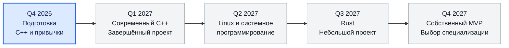

# 🧭 Квартальная дорожная карта 2026–2027

> [!abstract] Главная цель
> Построить последовательную инженерную базу: **C++ → системное программирование → Rust → собственный MVP**, постепенно уточняя специализацию.  
> **Спортпрограммирование не входит в эту карту.**

> [!info] Как пользоваться дашбордом
> - Отмечай задачи через `- [ ]` → `- [x]`.
> - В начале каждого месяца обновляй статусы и ближайшую цель.
> - Не переходи к следующему этапу только по календарю: сначала выполни критерии завершения.
> - Нагрузка — ориентир **10–14 часов в неделю** на все направления вместе.

## 📍 Текущий фокус

| Поле | Значение |
|---|---|
| **Активный этап** | Подготовка — Q4 2026 |
| **Главный приоритет** | C++ |
| **Текущая тема C++** | [[Классы и инкапсуляция]] |
| **Следующий результат** | Завершить практический проект на изученных темах |
| **Ритм** | 2–3 часа в день, с корректировкой по нагрузке |

> [!tip] Правило фокуса
> В каждый момент времени — **один главный учебный трек** и один основной практический проект. Остальные направления не должны отнимать время у текущего этапа.

## 🗺️ Карта года

## 🎛️ Статусы этапов

| Этап | Статус | Главный результат |
|---|---|---|
| **Q4 2026 · Подготовка** | 🟦 В процессе | Закрепить базу C++ и завершить текущий практический этап |
| **Q1 2027 · C++** | ⚪ Запланировано | Самостоятельно собрать и довести до конца проект |
| **Q2 2027 · Systems** | ⚪ Запланировано | Создать Linux-утилиту и понять базовые системные механизмы |
| **Q3 2027 · Rust** | ⚪ Запланировано | Написать небольшой проект, используя ownership и borrowing |
| **Q4 2027 · MVP** | ⚪ Запланировано | Выпустить первую рабочую версию собственного продукта |

---

## 🟦 Q4 2026 — Подготовительный этап

> [!todo] Статус: в процессе
> **Фокус:** закрепить основы C++, организовать рабочую систему обучения и подготовить фундамент для следующего года.

<progress max="100" value="0"></progress>

### Основные задачи

- [ ] Завершить тему [[Классы и инкапсуляция]].
- [ ] Закрепить `struct`, `enum`, `enum class`, указатели и динамическую память на практике.
- [ ] Довести до рабочего состояния небольшой консольный проект на C++.
- [ ] Привести репозиторий в порядок: понятная структура, README, история Git.
- [ ] Подготовить в Obsidian ссылки на учебные планы и журнал прогресса.

### Критерии завершения

- [ ] Могу объяснить устройство проекта и обосновать основные решения.
- [ ] Могу самостоятельно исправлять ошибки и добавлять функции.
- [ ] Проект собирается и запускается по инструкции.
- [ ] План Q1 2027 опирается на реальные пробелы, а не на предположения.

**Результат квартала:** готовая база для перехода от отдельных упражнений к более структурированным C++-проектам.

---

## ⚪ Q1 2027 — Современный C++ и инженерная практика

> [!note] Статус: запланировано
> **Фокус:** превратить знания языка в навык разработки поддерживаемого проекта.

<progress max="100" value="0"></progress>

### Основные задачи

- [ ] Продолжить C++ по основному плану: [[C++]].
- [ ] Освоить организацию проекта по нескольким `.h` / `.cpp` файлам.
- [ ] Научиться собирать проект через CMake.
- [ ] Уверенно пользоваться Git-ветками, коммитами и README.
- [ ] Изучать новые возможности C++ по мере необходимости проекта, не превращая обучение в бесконечное чтение.
- [ ] Завершить один самостоятельный проект с понятной областью ответственности каждого компонента.

### Критерии завершения

- [ ] Проект собирается через CMake на чистом каталоге сборки.
- [ ] Структура кода разделена на логичные компоненты.
- [ ] Есть README с описанием, сборкой и примерами запуска.
- [ ] Могу объяснить, как данные проходят через основные компоненты проекта.

**Результат квартала:** законченный C++-проект, который можно показать и развивать дальше.

---

## ⚪ Q2 2027 — Linux и системное программирование

> [!note] Статус: запланировано
> **Фокус:** разобраться, как программы взаимодействуют с операционной системой.

<progress max="100" value="0"></progress>

### Основные задачи

- [ ] Изучить процессы и базовые понятия управления выполнением программ.
- [ ] Разобраться с файловой системой, правами доступа и переменными окружения.
- [ ] Познакомиться с системными вызовами и их ролью.
- [ ] Изучить стандартный инструментарий Linux для диагностики программ.
- [ ] Создать одну небольшую Linux-утилиту на C++.
- [ ] Документировать эксперименты и ошибки в Obsidian.

### Критерии завершения

- [ ] Могу объяснить разницу между обычным вызовом библиотечной функции и системным вызовом.
- [ ] Могу диагностировать типичные ошибки доступа к файлам и запуска процессов.
- [ ] Утилита решает конкретную задачу, имеет обработку ошибок и инструкцию запуска.
- [ ] Могу объяснить ключевые решения и ограничения реализации.

**Результат квартала:** практическое знакомство с Linux internals и первый небольшой системный инструмент.

---

## ⚪ Q3 2027 — Rust

> [!note] Статус: запланировано
> **Фокус:** изучить Rust как отдельный инструмент после устойчивой практики на C++.

<progress max="100" value="0"></progress>

### Основные задачи

- [ ] Начать отдельный план [[Rust]].
- [ ] Изучить ownership, borrowing и lifetimes на практических примерах.
- [ ] Освоить `struct`, `enum`, `match`, `Result` и обработку ошибок в Rust.
- [ ] Сравнивать подходы Rust и C++ только там, где сравнение помогает понять модель языка.
- [ ] Создать небольшой законченный Rust-проект.
- [ ] Записывать в Obsidian сложные ошибки компилятора и выводы из них.

### Критерии завершения

- [ ] Могу объяснить ownership и borrowing своими словами и на примерах.
- [ ] Могу обосновать использование `Result` для ошибок.
- [ ] Проект собирается, имеет README и решает конкретную задачу.
- [ ] Могу самостоятельно разбирать большую часть ошибок компилятора.

**Результат квартала:** рабочая база Rust и понимание отличий его модели владения от C++.

> [!warning] Что пока не добавлять
> Не начинай [[Zig]] только потому, что он есть в списке целей. Сначала закрепи C++ и получи практический опыт с Rust. Возвращайся к Zig, когда текущая нагрузка позволяет добавить ещё один язык без потери качества.

---

## ⚪ Q4 2027 — Собственный MVP и выбор специализации

> [!note] Статус: запланировано
> **Фокус:** объединить инженерные навыки в полезный продукт и уточнить карьерное направление.

<progress max="100" value="0"></progress>

### Основные задачи

- [ ] Выбрать реальную проблему для собственного проекта.
- [ ] Определить минимальный набор функций MVP.
- [ ] Разбить работу на небольшие задачи и вести их через Git.
- [ ] Реализовать, протестировать и задокументировать MVP.
- [ ] Получить обратную связь и составить список улучшений.
- [ ] Сравнить профессиональные направления: [[Systems Engineer]], [[Backend Engineer]], [[DevOps Engineer]], [[Product Engineer]].
- [ ] Выбрать направление для следующего этапа развития на основании интереса и практического опыта.

### Критерии завершения

- [ ] MVP можно запустить и использовать для решения выбранной задачи.
- [ ] Есть README, инструкция запуска и список ограничений.
- [ ] Я могу объяснить архитектуру, компромиссы и следующие шаги.
- [ ] Выбор специализации опирается на выполненную работу, а не только на описание профессии.

**Результат квартала:** первая версия собственного продукта и обоснованный план дальнейшей специализации.

---

## 📊 Итоговый прогресс

Обновляй значения вручную по мере завершения этапов. Проценты — оценка выполненных критериев, а не количества прочитанных страниц.

| Квартал | Прогресс | Проверка результата |
|---|---:|---|
| Q4 2026 | 0% | База C++ и текущий проект |
| Q1 2027 | 0% | Завершённый C++-проект |
| Q2 2027 | 0% | Linux-утилита |
| Q3 2027 | 0% | Небольшой Rust-проект |
| Q4 2027 | 0% | MVP и выбор специализации |

## 🔁 Ежемесячный обзор

Заполняй в конце каждого месяца.

### Что сделано
- 

### Что оказалось сложнее, чем ожидалось
- 

### Какие пробелы нужно закрыть
- 

### Что я прекращаю или откладываю, чтобы сохранить фокус
- 

### Главный результат следующего месяца
- 

### Решение по плану
- [ ] Продолжить по плану.
- [ ] Уменьшить объём.
- [ ] Перенести отдельные задачи.
- [ ] Пересмотреть критерии квартала.

---

## 🔗 Связанные заметки

- [[C++]]
- [[Классы и инкапсуляция]]
- [[Rust]]
- [[Zig]]
- [[Systems Engineer]]
- [[Backend Engineer]]
- [[DevOps Engineer]]
- [[Product Engineer]]

> [!quote] Принцип дорожной карты
> **Не максимальное количество изученных тем, а подтверждённые навыки и завершённые проекты.**
